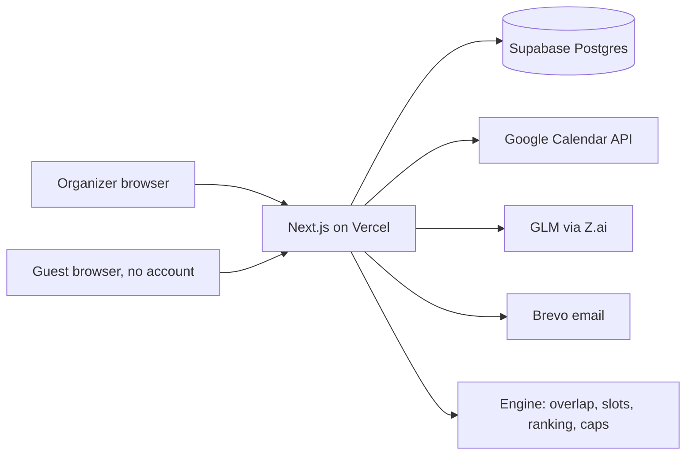

# Calendarly — Technical Spec

## How This Works, In Plain Language
Calendarly is a website. The organizer signs in with Google, connects their Google Calendar, and describes a meeting in plain words. The site makes a poll with a link. Group members open the link with no account, fill in a form, and can type when they are free. The organizer sees a dashboard and picks the final time.

There are five pieces, each with one job:
- **The website (Next.js on Vercel).** Shows the pages and runs the server code that answers every click.
- **The database (Supabase Postgres).** A set of spreadsheet-like tables holding polls, time slots, guests, votes, and what guests typed. Only the server reads and writes it.
- **Google Calendar.** The site asks Google only "when is this person busy?" and, for the organizer, "please create this event". It never reads titles or details.
- **The AI model (GLM from Z.ai).** Reads plain language and writes plain language. It does three jobs and nothing else.
- **Email (Brevo).** Sends exactly two emails: "new options added" and the confirmation.

**The one rule that shapes everything: code decides, the model interprets.** The AI model never decides what is allowed. Plain code works out who is free when, picks which slots exist, enforces "only when the organizer's calendar is free" and "at most 3 AI-added slots", and does the ranking. The model only (1) turns the organizer's text into structured constraints, (2) turns a guest's statement into proposed time ranges, and (3) writes the explanations. Whatever it returns is checked against a strict format first. If it returns nonsense, nothing is added and the guest is asked to rephrase. The model can be wrong, but it can never break your rules.

**Why this shape:** it is the smallest set of pieces that can prove the kernel (an AI that explains trade-offs and adds slots from plain language) with real calendars. Everything fancier from the old PRD (other calendars, live syncing, background jobs) is out.

## The Core Journey Through the System
PRD ref: `prd.md > The Core Journey`.

1. **Organizer signs in and connects the calendar** (`prd.md > The Core Journey` step 1). Sign-in goes through Supabase and Google. Then a separate "Connect Google Calendar" step asks Google for calendar permission. The server stores the permission token, encrypted, in the database.
2. **Organizer describes the meeting** (`prd.md > Poll creation in plain language`). The text goes to the server, then to the AI (job 1), which returns constraints in a fixed format, including who is required and how many people to expect. The server shows them for editing, along with an optional close time for the poll. On "Create poll" the server asks Google when the organizer is busy over the window, computes the free windows, cuts them into candidate slots (code), and saves the poll and slots.
3. **Organizer shares the link** (`prd.md > The Core Journey` step 3). The link contains a random token. The organizer sends it in WhatsApp, email or a chat. The app sends no invitation emails.
4. **A guest opens the link and fills the form** (`prd.md > Guest response`). The page loads the poll by token. On submit, the server saves a guest (name, email) and a vote per slot (yes, prefer not, no), and gives the browser a private cookie so the same guest can return. The server then counts responses; when the expected number have responded, it emails the organizer "6 of 6 have filled in" with a link to the dashboard (`prd.md > Poll completion and closing`).
5. **A guest types availability** (`prd.md > Guest plain-language availability`). The text, today's date and the guest's timezone go to the AI (job 2). It returns proposed time ranges in a fixed format. The server does not add anything yet. It shows "What I understood" (dates, times, timezone). The guest confirms or corrects.
6. **Slots are added by code** (`prd.md > AI-added slots`). On confirm, the server intersects the ranges with the organizer's free time, drops anything busy, skips duplicates, stops at the cap of 3, and saves new slots. It then emails the earlier voters "new options added".
7. **A connected guest's calendar** (optional) is handled the same way: the server asks Google for free/busy and marks their yes/no per slot automatically, and may propose slots from it. The form shows these marks pre-filled, and the guest can change any of them (an explicit vote overrides the calendar).
8. **Organizer opens the dashboard** (`prd.md > Ranking and AI summary`). The server loads slots, votes and statements, runs the ranking (code), then asks the AI (job 3) to write the summary and per-slot explanations from the numbers it is given. Code also works out the best slot overall and the best slot if each person were required (`conditionalAdvice`); the AI turns those into sentences like "If Sam must be there, choose option 2; otherwise option 1 works for 5 of 6." The dashboard also shows each person's stated preferences and the "4 of 6 responded" count. The page shows people, votes, the AI note and the ranking.
9. **Organizer picks a slot** (`prd.md > Finalizing`). The server creates the Google event on the organizer's calendar, saves the result, and emails every guest the confirmation with an "add to calendar" link. The organizer can close the poll before this; a closed poll accepts no new answers but can still be picked.



## Stack
Versions marked "verify" are not checked yet; check them in the first build step.

- **Language and framework:** TypeScript with Next.js (App Router), deployed on Vercel. Docs: https://nextjs.org/docs, https://vercel.com/docs. *Learner's stack; verify the current stable Next.js version.*
- **Database and sign-in:** Supabase (Postgres plus Auth with the Google provider). Docs: https://supabase.com/docs/guides/auth/social-login/auth-google. *Learner's stack.*
- **Email:** Brevo via SMTP (using `nodemailer`). Docs: https://developers.brevo.com/. *Learner's stack.*
- **AI model:** GLM (Z.ai) through its OpenAI-compatible API; the learner has a key. Docs: https://docs.z.ai. The model is chosen by an environment variable, so it is swappable. *Learner's stack; the learner said the model choice is flexible.*
- **Calendar:** Google Calendar API v3. Docs: https://developers.google.com/calendar/api/guides/overview.
- **Validation of AI output:** `zod`. Docs: https://zod.dev.
- **Dates and timezones:** `luxon`. Docs: https://moment.github.io/luxon/. *Agent recommendation; avoids hand-written timezone math.*
- **Styling:** Tailwind CSS with design tokens for the "warm planner" look; fonts via `next/font`. Docs: https://tailwindcss.com/docs. *Agent recommendation.*
- **Testing:** Vitest (unit and AI evals), Playwright (end-to-end), GitHub Actions (runs everything on each push). Docs: https://vitest.dev, https://playwright.dev, https://docs.github.com/actions. *Learner agreed to this plan.*
- **Development tooling:** the learner's Claude Code extensions and agentic workflows, plus Vercel's official MCP server (https://vercel.com/docs/agent-resources/vercel-mcp) and deploy plugin. *Verify the install commands against Vercel's docs when setting up.*
- **Design skill:** Anthropic's `frontend-design` skill, with `prd.md > Look and Feel` as its brief. *Verify before installing.*

## Where It Runs and How Someone Tries It
**Runtime:** a Node.js web app. Locally it runs at `http://localhost:3000`. Deployed, it runs on Vercel at a custom domain the learner will buy (Vercel sells domains and configures DNS automatically). Docs: https://vercel.com/docs/domains/working-with-domains.

**Requirements:** Node.js (verify the version Next.js needs), a Supabase project, a Google Cloud project with an OAuth consent screen, a Brevo account with a verified sender, and a Z.ai API key. Secrets live in `.env.local` (git-ignored) and in Vercel's environment settings. A secret-free `.env.example` lists the names only.

**Start locally:** `npm install`, copy `.env.example` to `.env.local`, fill the keys, then `npm run dev` and open `http://localhost:3000`.

**For the demo recording:** run the deployed site (or localhost) with the six demo accounts (`prd.md > Demo and Success Criteria`). Submission needs a short demo video and a public GitHub repository. The live URL is in addition to both.

**Google setup (do early):**
- Create the OAuth consent screen as *External*, in *Testing* mode, and add the demo Google accounts as test users. The authorized redirect URIs are `http://localhost:3000/...` and the production domain.
- Applying for verification needs the custom domain, a privacy page, a home page and a demo video of the consent flow. The `vercel.app` address cannot be verified because Vercel owns that domain. Start the application as soon as the privacy page exists, because review can take days to weeks.

**Tests:** `npm test` (unit), `npm run test:evals` (AI golden cases, mocked by default, `LIVE=1` for the real model), `npm run test:e2e` (Playwright demo path).

## Look and Feel
PRD ref: `prd.md > Look and Feel`. This restates the agreed direction; it does not re-open it.
- **Palette:** warm and paper-like: an off-white background, near-black warm text, one terracotta accent. Availability uses green (yes), amber (prefer not), and grey (no), each with an icon so color is never the only signal. Light and dark variants.
- **Typography:** a characterful serif for headings and the AI note, and a plain readable sans for body text. Proposed fonts (agent suggestion, for agreement): Fraunces for headings, DM Sans for body. Avoid the default Inter/system look.
- **Density and energy:** spacious and calm. Short lists of times, never a full calendar grid. Large tap targets, since guests will mostly be on phones.
- **Tone of copy:** plain and friendly. The AI summary reads like a short note from a colleague, not a chat bubble.
- **References:** Doodle for the guest form. Microsoft Teams' Scheduling Assistant is the competitor, not a style reference.
- **Constraints from the stack:** Tailwind with tokens can honor all of this. Fonts load through `next/font`. Dark mode comes from the tokens, with no extra libraries.

## Components

### Organizer Create Poll page
Route `/new`. One text box, then the poll as the AI understood it, editable (people, window, duration, hours, preferences). On "Create poll" it saves and shows the share link with a copy button.
PRD ref: `prd.md > Poll creation in plain language`, `prd.md > Screens and Layout > Organizer: Create Poll`.

### Organizer Poll Dashboard
Route `/poll/[id]` (signed-in organizer only). Shows people and calendar status, votes per slot (AI-added slots marked), the AI note, the ranking, and a "Pick this slot" action. A refresh button reloads the data; there is no live syncing.
PRD ref: `prd.md > Ranking and AI summary`, `prd.md > Finalizing`, `prd.md > Screens and Layout > Organizer: Poll Dashboard`.

### Guest Poll page
Route `/p/[token]`, no sign-in. Name (claim a listed name or type one), email, the options with yes / prefer not / no, optional "Connect Google Calendar", the plain-language box near the end, then submit. A returning guest sees their saved answers.
PRD ref: `prd.md > Guest response`, `prd.md > Screens and Layout > Guest: Poll Page`.

### "What I understood" step
A panel on the guest page shown after the plain-language text is analysed: dates, times, and the guest's timezone, with "Looks right" and "Correct it". Nothing is saved as a slot until "Looks right".
PRD ref: `prd.md > Guest plain-language availability`, `prd.md > Screens and Layout > Guest: "What I Understood" Step`.

### Calendar Adapter
One interface, `CalendarProvider`, with two methods: `getBusy(person, from, to)` and `createEvent(organizer, event)`. Two implementations:
- `GoogleCalendarProvider` calls Google's real API.
- `SeededCalendarProvider` returns hand-designed busy times for the demo accounts that are not real Google accounts. These are labeled "sample calendar" in the interface.

The tests use a third, in-memory fake. Only free/busy is ever read.
PRD ref: `prd.md > Privacy`, `prd.md > Demo and Success Criteria`.

### Slot and Ranking Engine (pure code)
Deterministic functions with no network access, so they can be fully tested:
- `buildFreeWindows` and `buildCandidateSlots`: from the organizer's busy times, working hours, window and duration, produce slots on a 30-minute grid *(assumption)*.
- `applyConstraints`: removes slots that break hard constraints and penalizes ones that break soft constraints.
- `statusFor`: for each person and slot, gives yes, prefer not, no, or unknown. A connected guest's calendar sets yes/no automatically; an explicit vote overrides it *(assumption)*.
- `rank`: orders slots by fewest "no", then fewest "prefer not", then constraint penalties, then spread across days. Weights: yes 1.0, prefer not 0.5, no 0 *(assumption, tunable; tests pin them)*.
- `addAiSlots`: intersects proposed ranges with the organizer's free windows, removes duplicates, and stops at the cap (a config value, 3).
- `conditionalAdvice`: for the top slot overall, and for each person treated as required, finds the best slot and who it leaves out, so "if Sam must be there, option 2; otherwise option 1" is computed by code, not guessed by the model.
- `isComplete`: compares responses with the expected count, and reports "4 of 6" for the dashboard and emails.
- `basisText`: builds the "based on 2 connected calendars, 2 votes, and 1 stated availability" line from counts, so the basis is never invented by the model.
PRD ref: `prd.md > AI-added slots`, `prd.md > Ranking and AI summary`.

### AI Layer
Everything that talks to the model lives in `src/lib/ai/`, behind one `complete(prompt, schema)` function that reads `AI_BASE_URL`, `AI_API_KEY` and `AI_MODEL`. The three jobs:

| Job | Input | Output (checked by a zod schema) |
|---|---|---|
| `parsePoll` | The organizer's text, today's date, the organizer's timezone | people (with notes, timezone, hours, and whether each is required), expected number of people, window, duration, working hours, constraints each marked `hard` or `soft`, and a list of things it did not understand |
| `parseStatement` | The guest's text, today's date, the guest's timezone | a plain-language restatement, a list of time ranges with timezone, a short preferences summary for the organizer, and anything ambiguous |
| `explain` | The ranked slots with their counts, constraint results, and the conditional alternatives (all computed by code) | a summary of the best and the not-best options, conditional advice sentences, and one explanation per slot |

Rules for all three: the model is given the date and timezone so "next week" has a fixed meaning; its answer must pass the schema; one automatic retry on invalid output; then a plain "I couldn't read that" result. The model is never given calendar event details, only counts and times. The model's output is never trusted for permissions or limits. Every call is recorded in `ai_runs` (input, output, valid or not, milliseconds) so behavior can be inspected and replayed.
PRD ref: `prd.md > Poll creation in plain language`, `prd.md > Guest plain-language availability`, `prd.md > Ranking and AI summary`.

### Guest Identity (no accounts)
The poll link carries a random token that finds the poll. After a guest submits, the server creates a guest row and sets an HTTP-only cookie holding a second random token, so the same browser sees its own answers again. Anyone with the link can respond; only the signed-in organizer can see the dashboard or pick.
PRD ref: `prd.md > States and Boundaries` (permissions, returning guest).

### Email
`sendConfirmation`, `sendNewOptions` and `sendPollUpdate` (to the organizer) send through Brevo SMTP. Every send is recorded in `email_log` with its result, so a failed send is visible and never blocks the page. Guest addresses are used only for the first two emails; `sendPollUpdate` goes to the organizer's own address from sign-in.
PRD ref: `prd.md > Emails`, `prd.md > AI-added slots`, `prd.md > Finalizing`.

### Calendar Connections
Organizer: Supabase sign-in handles identity. A separate "Connect Google Calendar" step asks for the calendar permissions and stores the token, encrypted, in `calendar_connections`. Guests who connect use a narrower availability-only permission and no account. Disconnecting deletes the token and revokes it with Google.
PRD ref: `prd.md > Privacy`.

### Poll Completion and Closing
After each guest submit, the server runs `isComplete`. When the expected number have responded, it sends `sendPollUpdate` once. The poll has an optional `close_at`; closing is checked on every request (a poll past its close time is treated as closed), and the organizer also has a "Close poll now" button, which sends the update immediately. A closed poll rejects new responses and still lets the organizer pick. *(Assumption: the update email at the scheduled close time needs a timer; see Decisions and Open Issues.)*
PRD ref: `prd.md > Poll completion and closing`, `prd.md > States and Boundaries`.

### Meet Again (stretch, last build slice)
Lowest priority, built only if the core flow is working and tested. On the guest form a "Remember me for future meetings with this organizer" checkbox (off by default) sets a consent flag on the guest and keeps their calendar connection. A "New meeting with this group" button on the dashboard copies the consenting guests into a new poll and uses their stored calendars to propose slots, so those guests need not answer again. Guests can disconnect, which removes the token and the consent. If it is not built, the demo narrates it as "next" and does not fake it.
PRD ref: the stretch goal under `prd.md > Product Decisions` and `prd.md > Deferred From the POC`.

### Test Suite
- **Unit (Vitest):** the engine: slot building, timezone handling (Jamie in BST, Europe/London), the cap, vote weighting, `basisText`, `conditionalAdvice`, and `isComplete`.
- **AI evals (Vitest):** golden cases per job, starting with the Tom/Jamie example and "Tuesday or Wednesday afternoons, not Mondays". They check the output format and key facts (which days, which hours, which timezone). By default they run against recorded model answers; with `LIVE=1` they call the real model and report a pass rate.
- **End-to-end (Playwright):** the demo path in a real browser: create a poll, a guest votes, a guest types availability and confirms it, slots are added, the organizer picks, the confirmation is recorded. It uses the in-memory fake calendar and a login that exists only when `E2E_TEST_MODE` is set.
- **Manual smoke test:** one run with real Google accounts before recording.
- **CI:** GitHub Actions runs unit, evals (mocked) and end-to-end on every push.

## Data Model
All times are stored in UTC (`timestamptz`) and shown in the viewer's timezone. Only the server reads and writes these tables. For each, "returning" says what happens when someone leaves and comes back.

| Table | What it holds | Updated by | Returning |
|---|---|---|---|
| `polls` | id, organizer user id, title, constraints (JSON), window, duration, working hours, expected count, required people, `close_at`, status (open, closed, or finalized), `share_token`, `final_option_id`, `google_event_id` | Create poll, finalize | Persists; the organizer finds it again on their dashboard |
| `options` | id, poll id, start, end, source (`organizer_free`, `guest_added`, `ai_added`), added by statement id | Create poll; confirmed statements | Persists |
| `guests` | id, poll id, name, email, timezone, `guest_token`, preferences summary, calendar connection id (optional), remember consent (stretch) | Guest form | The cookie finds them |
| `votes` | id, option id, guest id, choice (`yes`, `prefer_not`, `no`) | Guest form (editable until finalized) | Persists; the guest sees and can change them |
| `statements` | id, guest id, text, AI interpretation (JSON), confirmed (true or false), confirmed ranges | Guest plain-language step | Persists |
| `calendar_connections` | id, owner (organizer or guest), provider, encrypted token, scope, status | Connect, disconnect | Persists until disconnected |
| `ai_runs` | id, job, input, output, valid, milliseconds, created at | Every model call | Persists, for debugging and evals |
| `email_log` | id, kind, to, poll id, result, created at | Every send | Persists |

Where derived data lives: rankings are recomputed each time the dashboard loads and are not stored. Free/busy answers are fetched when needed and cached briefly in memory, with no background refresh.

## File Structure
```
calendarly/
├── src/
│   ├── app/
│   │   ├── page.tsx                  # landing / sign-in
│   │   ├── new/page.tsx              # Organizer Create Poll
│   │   ├── poll/[id]/page.tsx        # Organizer Poll Dashboard
│   │   ├── p/[token]/page.tsx        # Guest Poll page (+ What I understood)
│   │   └── api/
│   │       ├── polls/                # create, load, close, finalize, meet-again (stretch)
│   │       ├── guest/                # submit form, statement, confirm
│   │       ├── calendar/             # OAuth connect and callback, disconnect
│   │       └── test-login/           # exists only when E2E_TEST_MODE is set
│   ├── components/                   # form, slot list, availability chips, AI note
│   ├── lib/
│   │   ├── engine/                   # slots, constraints, status, rank, addAiSlots, conditionalAdvice, isComplete, basisText
│   │   ├── ai/                       # complete(), prompts, zod schemas, parsePoll, parseStatement, explain
│   │   ├── calendar/                 # CalendarProvider, google.ts, seeded.ts
│   │   ├── email/                    # Brevo SMTP sender, templates
│   │   ├── db/                       # Supabase server client, queries, migrations
│   │   └── config.ts                 # AI slot cap and other tunables
│   └── styles/                       # design tokens (palette, fonts)
├── tests/
│   ├── unit/                         # engine tests
│   ├── evals/                        # golden cases, recorded answers
│   ├── e2e/                          # Playwright demo path
│   └── fakes/                        # in-memory calendar, mock model
├── supabase/migrations/              # table definitions
├── .github/workflows/ci.yml          # runs all tests on push
├── devpost/                          # Devpost learning workspace
├── .env.example                      # variable names only, no secrets
├── package.json
└── README.md                         # how to run, test, and record the demo
```

## External Services and Dependencies
Everything below is unverified against live accounts; the first build step should confirm each one.

- **Google OAuth and Calendar API.**
  - Docs: https://developers.google.com/calendar/api/auth, https://developers.google.com/calendar/api/v3/reference/freebusy/query, https://developers.google.com/calendar/api/v3/reference/events/insert.
  - Free/busy: `POST https://www.googleapis.com/calendar/v3/freeBusy` with `{timeMin, timeMax, items:[{id:"primary"}]}`; the reply lists `calendars.primary.busy[]` as start/end pairs.
  - Create event (organizer only): `POST https://www.googleapis.com/calendar/v3/calendars/primary/events` with `{summary, start:{dateTime,timeZone}, end:{dateTime,timeZone}}`.
  - Scopes: `calendar.freebusy` for availability and `calendar.events` for the organizer's event. Google's reference pages disagree about which scope `freeBusy.query` accepts, so test it on day one and fall back to `calendar.readonly` if needed.
  - Keys: an OAuth client ID and secret. Cost: free. In Testing mode, only listed test users can connect, and I believe refresh tokens expire after 7 days (verify), so reconnect before recording.
- **Supabase.** Docs: https://supabase.com/docs. Keys: project URL, anon key, service-role key (server only, never in the browser). Free tier limits: verify.
- **Brevo SMTP.** Docs: https://developers.brevo.com/. Host and port from the Brevo dashboard; login is the account email; password is an SMTP key. The sender address or domain must be verified. Free-tier daily limit: verify.
- **Z.ai GLM.** Docs: https://docs.z.ai. `POST https://api.z.ai/api/paas/v4/chat/completions` with `Authorization: Bearer <key>` and an OpenAI-style body; the reply is in `choices[0].message.content`. Coding-plan keys may use a different base URL. Exact model ID and whether it offers a JSON mode: verify (we do not rely on one; the schema check covers us).
- **Vercel.** Docs: https://vercel.com/docs. Hosting, environment variables, custom domain. Whether the free plan fits after monetization: verify later.

## Important Failure Modes
- **The model returns something unreadable or wrong** → one automatic retry, then the guest sees "I couldn't read that. Try something like 'Tuesday or Wednesday afternoons, not Mondays'" and nothing is added. Covered by evals.
- **A Google token has expired or been revoked** (including the Testing-mode expiry) → that person is flagged on the dashboard with a "reconnect" prompt, and the ranking continues from everyone else.
- **The model is slow** (serverless time limits) → a loading state, a time limit, and the same "couldn't read that" path. Verify the Vercel function time limit early.
- **An email fails to send** → logged in `email_log`, the organizer sees "email not sent" on the dashboard, and the rest of the flow carries on.
- **No free time matches** → the guest or organizer sees the plain message from `prd.md > States and Boundaries`.

## What Was Simplified and Why
- **Guests have no accounts**; a link token and a cookie identify them — the PRD requires it, and it removes a whole sign-in system.
- **The database is only reachable from the server**, so there are no per-row access rules to configure. A browser can't read it directly.
- **Free/busy is fetched when needed**, with no webhooks and no background jobs. The earlier Claude Docs PRD planned Google webhooks for caching; for six people that is not needed.
- **Poll closing is checked on each request**, not by a timer. A scheduled email at the close time would need a background job, so it is optional (see Open Issues). "Close poll now" and "everyone has filled in" cover the demo.
- **The dashboard refreshes with a button**, not live updates, because live syncing is hard to build and debug.
- **Guests get an "add to calendar" link, not a write to their own calendars.** Only the organizer's calendar gets the event, as in `prd.md > Finalizing`.
- **Some demo accounts use sample calendars** (`SeededCalendarProvider`), labeled as such, so the "no perfect slot" case can be designed exactly.
- **Sign-in is Google only** *(proposal)*. The earlier Claude Docs PRD allowed email sign-in too. Dropping it removes a second sign-in path, and Supabase's own sign-in emails.
- **One Google Cloud project and Testing mode first**; verification is attempted in parallel and is not a build blocker.

## Decisions and Open Issues

### Learner decisions
- **Stack unchanged:** Next.js on Vercel, Supabase, Brevo SMTP, GLM (Z.ai), Google Calendar.
- **Model:** flexible; the learner has a GLM key, so GLM is first, behind a swappable adapter.
- **Live URL on a custom domain**, bought through Vercel, in addition to the video and repository. Reason: the Google verification attempt needs a domain the learner owns.
- **Tooling:** use the learner's Claude Code extensions and agentic workflows, plus Vercel's MCP server and deploy plugin.
- **Testing:** fully automated, as described under Test Suite, including a test-only login for end-to-end tests.
- **Demo:** 1–3 minutes, six people, a university group-project scenario; "X of Y have filled in" email to the organizer; the organizer can also set a close time; conditional advice when no option suits everyone; guests' stated preferences visible to the organizer; connected guests see pre-filled marks.
- **Meet again** is a stretch goal and last priority in the build and the demo.
- **Learning goals:** understand how the AI architecture works, how the tests work, and move toward being a good AI developer.

### Derived by the agent (need agreement at review)
- Google-only sign-in; the database reachable only from the server; no webhooks or background jobs; guests identified by a link token and cookie; add-to-calendar by link; sample-calendar demo accounts; dashboard refresh button.
- Slot grid of 30 minutes and a default duration of 60 minutes shown for the organizer to edit; vote weights (yes 1.0, prefer not 0.5, no 0); an explicit vote overrides a connected calendar's automatic answer.
- Hard versus soft constraints: "can't do Tuesdays" is hard, "does not like nights" is soft.
- Proposed fonts: Fraunces and DM Sans.
- The relative-phrase mechanism (this answers `prd.md > Open Questions`): the model is told today's date and the guest's browser timezone; the guest sees the timezone and can change it; the "What I understood" step shows concrete dates before anything is added.

### The learner's technical uncertainty
How the AI part works. What clarified it: the "code decides, the model interprets" rule, the three jobs with fixed input and output formats, and the `ai_runs` log. The agreed investigation during the build: when `parsePoll` works, open one `ai_runs` row together, then run the eval report and read which cases pass or fail and why. Evidence: the golden cases pass, and the learner can explain what the model is and is not trusted to do.

### Still open
- **Scheduled close-time email:** needs a timer. Vercel offers cron jobs, but their limits depend on the plan (verify). If they don't fit, the email is sent on "Close poll now" and when the last expected guest responds, and the scheduled version moves to Later.
- **"Who is required"** is read from the organizer's text by `parsePoll` and shown for editing. If the model misses it, the organizer can mark people as required in the editable summary.
- **Google verification** (`prd.md > Open Questions`): needs the domain, a privacy page, a home page and a consent-flow video. Start as soon as the domain exists.
- **Demo calendars** (`prd.md > Open Questions`): design the six accounts' calendars for the "no perfect slot" case, and decide which are real Google accounts and which are sample. Done in `5-build`.
- **AI-added slot cap:** stays at 3, as a config value.
- **Group size check:** the ranking and dashboard need a check at 20 people before that size is claimed.
- **Scope versus time:** build the end-to-end demo path first, with the real Google calendar and the real model arriving as soon as possible.
- **Self-review:** the earlier Claude Docs PRD still lists email sign-in and Supabase-sent emails; this spec drops both (see proposal above). The Claude Docs PRD should be updated if the learner agrees.
